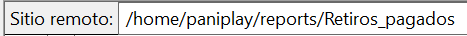

# Repositorio retiros pagados - Paniplay.

Para ingresar al servidor de Paniplay, es necesario conectarte al servidor, dando clic en el ícono de servidores, al dar clic en este ícono, se desplegarán los servidores disponibles, debes seleccionar el servidor "**Paniplay**".

<figure><figcaption>
Figura #1: Captura de pantalla "Servidores".
</figcaption></figure>

Al seleccionar en servidor, en el apartado derecho de FileZilla, podrás ver el repositorio de este mismo.

<figure><figcaption>
Figura #2: Captura de pantalla Repositorio.
</figcaption></figure>

La ruta para llegar al archivo con la información de los repositorios pagados será la siguiente:&#x20;

<figure><figcaption>
Figura #3: Captura de pantalla Ruta.
</figcaption></figure>

Al encontrarnos en esta ruta, podremos encontrar los reportes separados en carpetas con el nombre de los meses.

<figure><figcaption>
Figura #4: Captura de pantalla mes.
</figcaption></figure>

Ingresamos a la carpeta del mes correspondiente y vamos a encontrar un archivo en formato Excel llamado "retiros\_pagados\_paniplay.csv.

<figure><figcaption>
Figura #5: Captura de pantalla archivo Excel.
</figcaption></figure>

Al hacer clic en este archivo, se descargará automáticamente en tu dispositivo, generalmente en la carpeta de descargas. Al abrirlo, encontrarás las siguientes columnas con información detallada:

* **Partner**: El partner con el que se generó el reporte.
* **País**: El país en el que se generó el reporte.
* **Fecha\_creacion**: La fecha en la que se generó el reporte.
* **Fecha\_de\_pago**: La fecha en la que se realizó el pago al usuario.
* **Id\_retiro**: Un identificador único generado para identificar el retiro.
* **id\_usuario**: El identificador de la cuenta del usuario.
* **Nombre\_Completo**: El nombre completo del usuario que generó el reporte.
* **Tipo\_de\_identificacion**: El tipo de documento de identificación del usuario.
* **Numero\_documento**: El número de documento con el que se identifica el usuario.
* **Valor\_retiro**: El monto retirado por el usuario.
* **Medio\_retiro**: El medio utilizado para realizar el pago al usuario.
* **Nombre\_medio\_retiro**: El nombre del medio que utilizó el usuario para efectuar su retiro.
* **Estado**: El estado del retiro (En este reporte, solo aparecerán aquellos con el estado "pagado").
