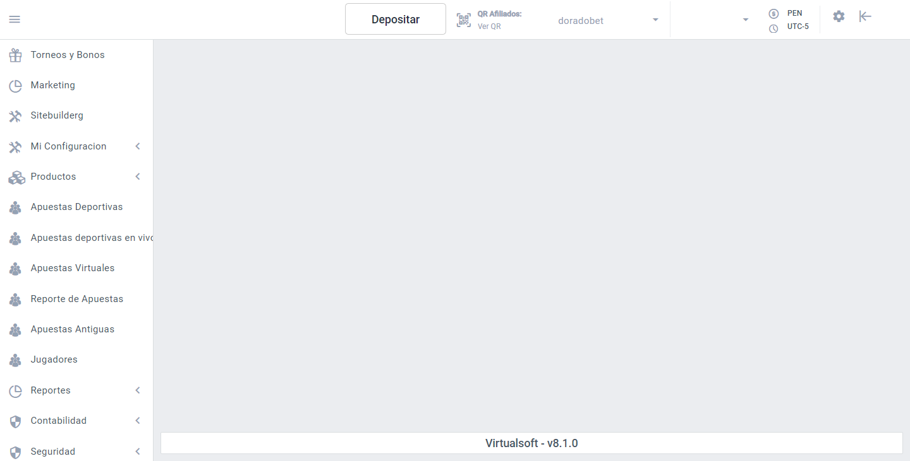

# Acceso a la plataforma.

## **Acceder al BackOffice**

Para iniciar, accede al BackOffice mediante la siguiente URL:

[https://admin.virtualsoft.tech/](https://admin.virtualsoft.tech/)

Una vez que hayas iniciado sesión, serás redirigido a la interfaz principal. En la **barra lateral**, encontrarás diversas opciones.

En esta barra debes seleccionar la opción "**Marketing**".

Al seleccionar esta opción, se abrirá la siguiente página. La primera vista corresponde al **Dashboard** de la plataforma.

En esta interfaz, se pueden visualizar distintas métricas y estadísticas organizadas en tarjetas. La parte superior presenta filtros de tiempo, permitiendo seleccionar datos de **Hoy**, **Ayer**, **Últimos 30 días** o un rango personalizado mediante un selector de fechas. 

<figure><figcaption>
Figura #2: Captura de pantalla Marketing.
</figcaption></figure>

El **panel lateral izquierdo** contiene un menú con distintos accesos directos a funcionalidades clave del sistema, para acceder a su información puedes dar clic en la página correspondiente.


[mensaje.md](mensaje.md)



[pop-up.md](pop-up.md)



[banner-invasivo.md](banner-invasivo.md)



[franja-superior.md](franja-superior.md)



[emails.md](emails.md)



[sms.md](sms.md)



[notificaciones-push.md](notificaciones-push.md)



[plantillas.md](plantillas.md)

