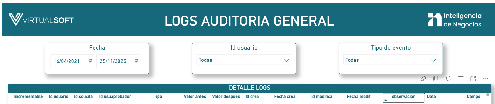

---
layout:
  width: default
  title:
    visible: true
  description:
    visible: false
  tableOfContents:
    visible: true
  outline:
    visible: true
  pagination:
    visible: true
  metadata:
    visible: true
  tags:
    visible: true
  actions:
    visible: true
  anchors:
    visible: true
---

# Logs Auditoría general

Este tablero está diseñado para ser utilizado por parte del área de calidad al momento de realizar pruebas a los desarrollos necesarios, aquí se visualizarán los logs de las solicitudes en la plataforma de Usuarios Online.

***

### 1. Acceso al Módulo

**Ruta de acceso**: [Acceso directo.](https://app.powerbi.com/groups/21a674db-4a43-4cbe-aa04-dd1344d20b35/reports/4a67497b-24f7-4d22-8aa1-c73dbe69327e/094131902000702a1754?ctid=1317ec1d-550c-46b5-8697-0f2a1a8e71b0\&experience=power-bi\&clientSideAuth=0)

***

### 2. Visualización

<figure><figcaption>
Figura #1: Captura de pantalla Logs.
</figcaption></figure>

***

### 3. Acciones del Usuario

| Acción                    | Descripción                                                 |
| ------------------------- | ----------------------------------------------------------- |
| **`Filtrar información`** | Filtra los datos de los logs según los criterios definidos. |
| **`Exportar datos`**      | Descargar información en formatos _(Excel, CSV, PDF)_.      |

***

#### 4. Filtros disponibles


**Nota**: Los filtros dependen del rango de fechas seleccionado. Si se elige un rango amplio, es posible que se cargue un volumen elevado de registros.


<table><thead><tr><th width="129">Campo</th><th width="159">Tipo de control</th><th>Descripción</th></tr></thead><tbody><tr><td><strong><code>Fecha</code></strong></td><td>Selector de rango</td><td>Permite establecer una fecha de inicio y una fecha de fin para visualizar los registros.</td></tr><tr><td><strong><code>ID Usuario</code></strong></td><td>Lista desplegable</td><td>Filtra los registros por el identificador específico de un usuario.</td></tr><tr><td><strong><code>Tipo de evento</code></strong></td><td>Lista desplegable</td><td>Permite seleccionar el tipo de evento registrado en el sistema <em>(ej. creación, modificación).</em></td></tr></tbody></table>

***

#### **4.1. Detalle Logs**

Presenta una tabla llamada **Detalle Logs**, donde se visualiza la trazabilidad de acciones realizadas.


**Nota:** Algunos campos pueden variar según el módulo que generó el evento.


<table><thead><tr><th width="226">Campo</th><th>Descripción</th></tr></thead><tbody><tr><td><strong><code>Incrementable</code></strong></td><td>Identificador de log de menare incremental.</td></tr><tr><td><strong><code>ID Usuario</code></strong></td><td>Identificador único del usuario asociado al evento registrado.</td></tr><tr><td><strong><code>ID Solicita</code></strong></td><td>Identificador del usuario que generó la solicitud o movimiento en la plataforma.</td></tr><tr><td><strong><code>ID Usuario Aprobador</code></strong></td><td>Usuario que aprobó <em>(si aplica)</em> la acción registrada.</td></tr><tr><td><strong><code>Tipo</code></strong></td><td>Tipo de evento ejecutado <em>(crear, modificar, eliminar, login, etc.).</em></td></tr><tr><td><strong><code>Valor Antes</code></strong></td><td>Valor previo al cambio registrado.</td></tr><tr><td><strong><code>Valor Después</code></strong></td><td>Valor posterior al cambio.</td></tr><tr><td><strong><code>ID Crea</code></strong></td><td>Identificador de quien creó el registro.</td></tr><tr><td><strong><code>Fecha Crea</code></strong></td><td>Fecha y hora en la que se creó el log.</td></tr><tr><td><strong><code>ID Modifica</code></strong></td><td>Identificador de quien realizó la modificación <em>(si aplica).</em></td></tr><tr><td><strong><code>Fecha Modifica</code></strong></td><td>Momento exacto en que se modificó el registro.</td></tr><tr><td><strong><code>Observación</code></strong></td><td>Descripción o notas adicionales del evento.</td></tr><tr><td><strong><code>Data</code></strong></td><td>Información técnica adicional del objeto afectado.</td></tr><tr><td><strong><code>Campo</code></strong></td><td>Campo específico que fue modificado <em>(si es un evento de edición).</em></td></tr></tbody></table>

***

### 5. Control de Versiones

🔽Historial de versiones

| Versión | Fecha      | Autor         | Cambios Realizados          |
| ------- | ---------- | ------------- | --------------------------- |
| 1.0     | 25/11/2025 | Ronald Peláez | Documento inicial generado. |
| 1.1     | 19/08/2026 | Ronald Peláez | Ajustes en formato          |

