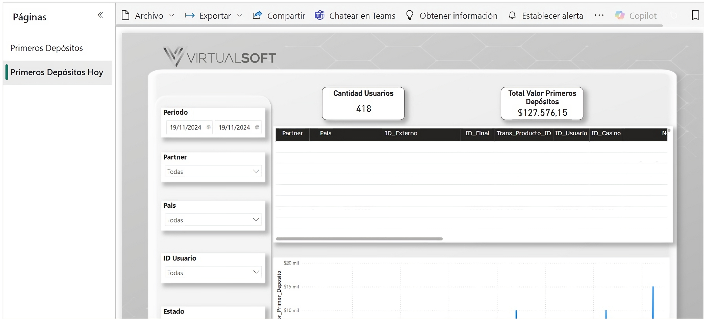

---
layout:
  width: default
  title:
    visible: true
  description:
    visible: false
  tableOfContents:
    visible: true
  outline:
    visible: true
  pagination:
    visible: true
  metadata:
    visible: true
  tags:
    visible: true
  actions:
    visible: true
  anchors:
    visible: true
---

# Tablero de Primeros Depósitos.


**Nota**: Este manual ya no se encuentra en funcionamiento debido a que el tablero ya no se utiliza.


Este tablero está diseñado para visualizar y analizar la información correspondiente a los primeros depósitos realizados por los usuarios. La información puede ser consultada mediante diferentes filtros y visualizaciones que facilitan el análisis de los depósitos realizados durante el día actual.

### **1. Acceso al Módulo**

**Ruta de acceso**: Desde el menú lateral izquierdo, ingresar a la sección **Páginas** y seleccionar la página **Primeros Depósitos Hoy**.

***

### **2. Visualización**

En la sección **Páginas** se encuentran las diferentes páginas que conforman el tablero. Para consultar la información correspondiente a los primeros depósitos del día, se debe seleccionar la página **Primeros Depósitos Hoy**.

<figure><figcaption>
Figura #1: Captura de pantalla Tablero.
</figcaption></figure>

***

### **3. Acciones del Usuario**

| Acción                      | Descripción                                                                                                      |
| --------------------------- | ---------------------------------------------------------------------------------------------------------------- |
| **`Filtrar información`**   | Filtra la información de los primeros depósitos según los criterios definidos.                                   |
| **`Consultar información`** | Permite visualizar los datos generales y detallados de los primeros depósitos registrados durante el día actual. |
| **`Consultar gráfico`**     | Permite visualizar gráficamente la suma del valor de los primeros depósitos según las fechas correspondientes.   |

***

### **4. Filtros disponibles**

<table><thead><tr><th width="129">Campo</th><th width="159">Tipo de control</th><th>Descripción</th></tr></thead><tbody><tr><td><strong><code>Periodo</code></strong></td><td>Selector de fechas</td><td>Permite filtrar la información según fechas específicas.</td></tr><tr><td><strong><code>Partner</code></strong></td><td>Lista desplegable</td><td>Permite filtrar la información según el partner seleccionado.</td></tr><tr><td><strong><code>País</code></strong></td><td>Lista desplegable</td><td>Permite filtrar la información según el país seleccionado.</td></tr><tr><td><strong><code>ID de usuario</code></strong></td><td>Campo de búsqueda</td><td>Permite consultar la información correspondiente a un usuario específico.</td></tr><tr><td><strong><code>Estado</code></strong></td><td>Lista desplegable</td><td>Permite filtrar la información según el estado en el que se encuentre el depósito.</td></tr></tbody></table>


**Nota**: La información de la sección **Primeros Depósitos Hoy** corresponde únicamente al día actual y se actualiza cada 2 horas.


***

### **5. Información Primeros Depósitos**

Presenta la información correspondiente a los primeros depósitos realizados durante el día actual, tanto de manera general como de acuerdo con los criterios seleccionados en los filtros.

La información se actualiza cada 2 horas en los siguientes horarios:

* 7:00 a.m.
* 9:00 a.m.
* 11:00 a.m.
* 1:00 p.m.
* 3:00 p.m.
* 5:00 p.m.
* 7:00 p.m.
* 9:00 p.m.

<table><thead><tr><th width="226">Campo</th><th>Descripción</th></tr></thead><tbody><tr><td><strong><code>Cantidad de usuarios</code></strong></td><td>Conteo total de usuarios que han realizado depósitos hasta el momento de la última actualización.</td></tr><tr><td><strong><code>Total valor de Primeros Depósitos</code></strong></td><td>
Valor total de los primeros depósitos realizados hasta el momento de la última actualización.

<strong>Nota</strong>: El valor mostrado en <strong>Total valor de Primeros Depósitos</strong> corresponde a la sumatoria de los depósitos realizados y no contempla la conversión de los valores a una única moneda.

</td></tr><tr><td><strong><code>Partner</code></strong></td><td>Partner con el cual el usuario realizó el depósito.</td></tr><tr><td><strong><code>País</code></strong></td><td>País en el cual el usuario realizó el depósito.</td></tr><tr><td><strong><code>ID_externo</code></strong></td><td>Identificador de la recarga asignado por el proveedor.</td></tr><tr><td><strong><code>ID_final</code></strong></td><td>Identificador de la recarga asignado por VirtualSoft.</td></tr><tr><td><strong><code>Trans_Producto_ID</code></strong></td><td>Identificador de la transacción realizada por el usuario.</td></tr><tr><td><strong><code>ID_usuario</code></strong></td><td>Identificador del usuario que realizó el depósito.</td></tr><tr><td><strong><code>ID_Casino</code></strong></td><td>Identificador del usuario casino que realizó el depósito.</td></tr><tr><td><strong><code>Nombre_Usuario</code></strong></td><td>Nombre del usuario que realizó el depósito.</td></tr><tr><td><strong><code>Fecha_Primer_Deposito</code></strong></td><td>Fecha en la que el usuario realizó el primer depósito.</td></tr><tr><td><strong><code>ID_Recarga</code></strong></td><td>Identificador de la recarga realizada por el usuario al generar el primer depósito.</td></tr><tr><td><strong><code>Valor_Primer_Deposito</code></strong></td><td>Valor correspondiente al primer depósito realizado por el usuario.</td></tr><tr><td><strong><code>Nombre_Proveedor</code></strong></td><td>Nombre del proveedor con el cual se realizó el depósito.</td></tr><tr><td><strong><code>Nombre_Pasarela_pago</code></strong></td><td>Nombre de la pasarela de pago utilizada para realizar el depósito.</td></tr><tr><td><strong><code>Estado</code></strong></td><td>Estado en el que se encuentra el depósito.</td></tr><tr><td><strong><code>Gráfico</code></strong></td><td>Primeros depósitos registrados en la tabla, específicamente la suma del valor de los primeros depósitos y las fechas correspondientes.</td></tr></tbody></table>

***

### **6. Control de Versiones**

🔽Historial de versiones

| Versión | Fecha      | Autor         | Cambios Realizados                                                             |
| ------- | ---------- | ------------- | ------------------------------------------------------------------------------ |
| 1.0     | 18/08/2026 | Ronald Peláez | [Documento inicial.](https://virtualsoftlatam.atlassian.net/browse/VSFT-32856) |

