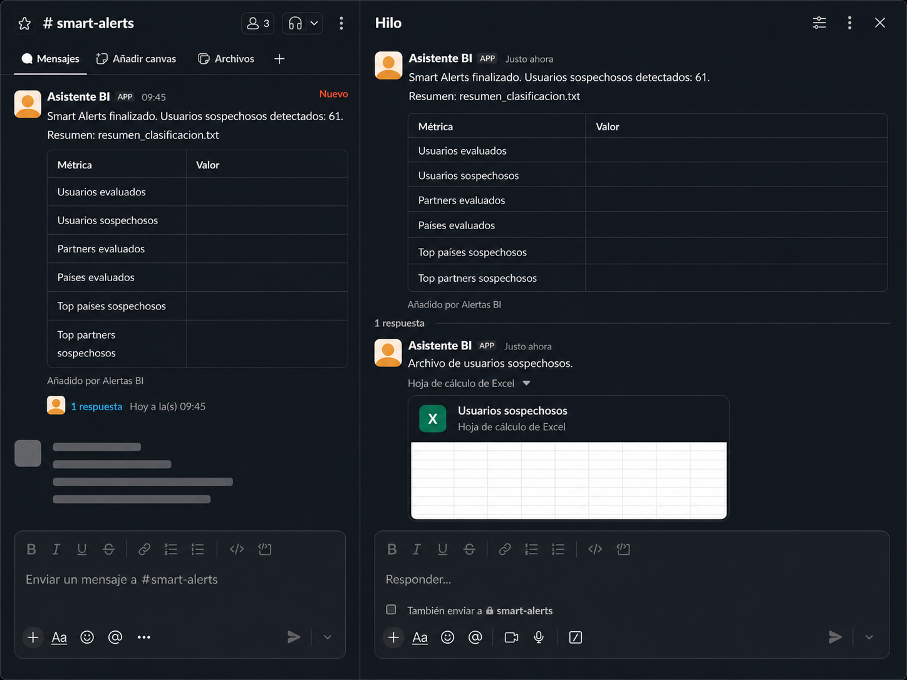

---
layout:
  width: default
  title:
    visible: true
  description:
    visible: false
  tableOfContents:
    visible: true
  outline:
    visible: true
  pagination:
    visible: true
  metadata:
    visible: true
  tags:
    visible: true
  actions:
    visible: true
  anchors:
    visible: true
---

# Usuarios Sospechosos

<mark style="color:$info;">La alerta de</mark> <mark style="color:$info;"></mark><mark style="color:$info;">**Usuarios Sospechosos**</mark> <mark style="color:$info;"></mark><mark style="color:$info;">es una notificación automática enviada por</mark> [<mark style="color:$info;">Slack</mark>](https://virtualsoft.gitbook.io/plantillas/glosario#slack) <mark style="color:$info;">al canal</mark> <mark style="color:$info;"></mark><mark style="color:$info;">**#smart-alerts**</mark> <mark style="color:$info;"></mark><mark style="color:$info;">cada hora. Esta alerta presenta un resumen de los resultados obtenidos durante el análisis de los usuarios. Adicionalmente, el mensaje incluye el archivo adjunto llamado</mark> <mark style="color:$info;"></mark><mark style="color:$info;">**Usuarios Sospechosos**</mark><mark style="color:$info;">, el cual contiene el detalle de los usuarios identificados durante la ejecución como posibles casos de interés para revisión, junto con la información para realizar su clasificación.</mark> 

### 1. Acceso

La recepción de las alertas se realiza de forma automática a través de **Slack**.


**Nota:** En caso de no visualizar el canal o no recibir notificaciones, solicitar acceso al área de soporte.


***

### 2. Visualización:

<figure><figcaption>
Figura #1: Captura de pantalla ejemplo del reporte.
</figcaption></figure>

***

### 3. Funcionamiento General

Slack envía automáticamente cada hora un reporte al canal #smart-alerts, el cual incluye un mensaje con la información:&#x20;

<table><thead><tr><th width="249">Métrica</th><th>Descripción</th></tr></thead><tbody><tr><td><strong><code>Usuarios evaluados</code></strong></td><td>Cantidad total de usuarios analizados por el modelo durante la ejecución.</td></tr><tr><td><strong><code>Usuarios sospechosos</code></strong></td><td>Número y porcentaje de usuarios clasificados como sospechosos.</td></tr><tr><td><strong><code>Partners evaluados</code></strong></td><td>Cantidad de partners incluidos en el análisis.</td></tr><tr><td><strong><code>Países evaluados</code></strong></td><td>Número de países considerados durante la ejecución.</td></tr><tr><td><strong><code>Top países sospechosos</code></strong></td><td>Países con mayor cantidad de usuarios clasificados como sospechosos.</td></tr><tr><td><strong><code>Top partners sospechosos</code></strong></td><td>Partners con mayor cantidad de usuarios clasificados como sospechosos.</td></tr></tbody></table>

***

### 4. Estructura del Archivo - Usuarios Sospechosos

El archivo **Usuarios Sospechosos** contiene el detalle de los usuarios que fueron clasificados como potencialmente anómalos por el modelo de detección. Cada registro incluye información del perfil del usuario, actividad reciente y métricas utilizadas durante el proceso de evaluación.

<table><thead><tr><th width="310">Campo</th><th width="376">Descripción</th></tr></thead><tbody><tr><td><strong><code>USUARIO_ID</code></strong></td><td>Identificador único del usuario evaluado.</td></tr><tr><td><strong><code>PARTNER</code></strong></td><td>Partner al que pertenece el usuario.</td></tr><tr><td><strong><code>PAIS</code></strong></td><td>País asociado al usuario o a la operación evaluada.</td></tr><tr><td><strong><code>PERFIL_ID</code></strong></td><td>Tipo de usuario al que se le realizó la evaluación. <em>(Por ejemplo: Usuario Online, Punto de venta etc).</em></td></tr><tr><td><strong><code>SEGMENTO_VIP</code></strong></td><td>Indica si el usuario pertenece a VIP.</td></tr><tr><td><strong><code>TOTAL_CONTINGENCIAS_ACTIVAS</code></strong></td><td>Cantidad de contingencias activas registradas para el usuario al momento de la evaluación.</td></tr><tr><td><strong><code>ACCIONES_EN_CONTINGENCIA</code></strong></td><td>Número de acciones realizadas mientras el usuario se encontraba en estado de contingencia.</td></tr><tr><td><strong><code>TOTAL_ACCIONES_EVALUADAS</code></strong></td><td>Total de acciones consideradas por el modelo para realizar la clasificación.</td></tr><tr><td><strong><code>TOTAL_APUESTAS_ULTIMAS_ACCIONES</code></strong></td><td>Valor acumulado de apuestas realizadas en las acciones evaluadas más recientes.</td></tr><tr><td><strong><code>TOTAL_PREMIOS_ULTIMAS_ACCIONES</code></strong></td><td>Valor acumulado de premios obtenidos durante las acciones evaluadas.</td></tr><tr><td><strong><code>TOTAL_DEPOSITOS_ULTIMAS_ACCIONES</code></strong></td><td>Valor acumulado de depósitos realizados en las acciones evaluadas.</td></tr><tr><td><strong><code>TOTAL_RETIROS_ULTIMAS_ACCIONES</code></strong></td><td>Valor acumulado de retiros realizados en las acciones evaluadas.</td></tr><tr><td><strong><code>FECHA_ULTIMA_ACCION</code></strong></td><td>Fecha y hora de la última acción registrada para el usuario.</td></tr><tr><td><strong><code>anomaly_score</code></strong></td><td>Puntaje calculado por el modelo de anomalías. Entre más alto sea el valor, mayor es la probabilidad de que el comportamiento sea considerado atípico.</td></tr><tr><td><strong><code>es_sospechoso</code></strong></td><td>Indica si el usuario fue clasificado como sospechoso.</td></tr><tr><td><strong><code>MOTIVO_CLASIFICACION</code></strong></td><td>Descripción del criterio o comportamiento detectado que originó la clasificación del usuario como sospechoso.</td></tr><tr><td><strong><code>ULTIMAS_10_ACCIONES</code></strong></td><td>
Resumen de las diez acciones más recientes realizadas por el usuario que fueron consideradas durante el análisis.

<strong>Nota:</strong> La información presentada en este campo corresponde a la misma que se encuentra disponible en el reporte <a data-mention href="https://app.gitbook.com/s/UadX6RX6l8fMhEZxOqcT/manual-de-usuario-backoffice/jugadores/reportes-seccion-jugadores/historial-de-movimientos">Historial de movimientos</a> Los usuarios visualizados en esta sección son únicamente aquellos que han registrado algún movimiento durante la última hora. Adicionalmente, la sección muestra únicamente las acciones realizadas por el usuario durante los últimos tres meses.

</td></tr></tbody></table>

***

### 4. Validaciones y reglas del negocio

* Smart Alerts ejecuta automáticamente el proceso de análisis de usuarios cada hora y envía los resultados al canal **#smart-alerts** de Slack.
* Junto con el mensaje, el sistema adjunta el archivo **Usuarios Sospechosos**, el cual contiene el detalle de los usuarios identificados durante la ejecución.

***

### **5. Control de Versiones**

🔽Historial de versiones

<table><thead><tr><th width="101">Versión</th><th width="170">Fecha</th><th width="142">Autor</th><th>Cambios Realizados</th></tr></thead><tbody><tr><td>1.0</td><td>23/06/2026</td><td>Karol Navia</td><td>Creación del documento</td></tr></tbody></table>

